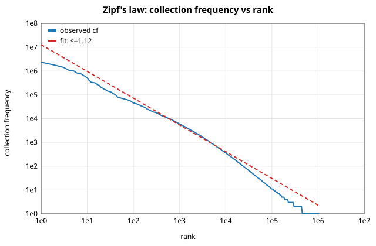
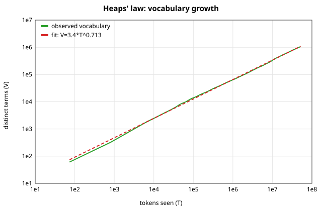

# Index statistics report

* corpus: `hiwiki-latest-pages-articles.xml.bz2` (wiki), language `hi`
* documents: **176,041**  |  tokens: **51,604,144**  |  vocabulary: **1,054,110**  |  postings (term,doc pairs): **22,468,149**
* average document length: 293.1 tokens
* hapax legomena (cf = 1): 600,049 (56.9% of vocabulary)
* build: 104 SPIMI runs, 4 workers, inversion 107.46s, total 140.13s

## Zipf's law
cf ∝ rank^-s (fitted on ranks 10..10,000) with **s = 1.125** (R² = 0.9894).  

## Heaps' law
V = K·T^β with **K = 3.44, β = 0.713** (R² = 0.9992).  

## Compression of postings (estimated from a sample of terms, scaled)

| encoding | size (MiB) |
|---|---:|
| uncompressed 32-bit integers | 451.5 |
| **VByte gaps (actual file, incl. skip tables)** | **145.2** |
| Elias-γ gaps (estimate) | 129.6 |
| Elias-δ gaps (estimate) | 122.9 |

VByte gives a **3.11x** reduction over raw 32-bit integers while staying byte-aligned (fast to decode in Python).

## Memory: vocabulary in RAM
* front-coded lexicon (blocks of 16): **18.00 MiB** (loaded in 0.03s)
* the same vocabulary as a Python dict: ~284.0 MiB

## Terms by script

| script | terms |
|---|---:|
| devanagari | 862,713 |
| latin | 171,918 |
| digit | 15,335 |
| bengali | 1,434 |
| tamil | 637 |
| gurmukhi | 508 |
| telugu | 394 |
| kannada | 356 |
| malayalam | 340 |
| oriya | 246 |
| gujarati | 229 |

## Document-frequency distribution

| df bucket | terms |
|---|---:|
| df<=1 | 710,819 |
| df<=2 | 125,446 |
| df<=3 | 99,484 |
| df<=10 | 42,782 |
| df<=100 | 58,239 |
| df<=1000 | 14,132 |
| df>1000 | 3,208 |

## Most frequent terms

| term | cf | df |
|---|---:|---:|
| के | 2,341,229 | 144,526 |
| में | 1,759,957 | 141,631 |
| है | 1,439,448 | 150,988 |
| की | 1,080,075 | 111,191 |
| और | 1,029,308 | 93,622 |
| से | 819,480 | 98,313 |
| का | 802,744 | 117,650 |
| को | 680,104 | 76,413 |
| एक | 591,216 | 143,574 |
| हैं | 504,290 | 79,641 |
| पर | 400,864 | 86,412 |
| किया | 342,151 | 66,233 |
| ने | 329,963 | 52,266 |
| लिए | 322,407 | 58,147 |
| भी | 311,986 | 91,253 |
| था | 279,832 | 56,329 |
| यह | 256,963 | 71,916 |
| गया | 252,507 | 57,636 |
| रूप | 227,244 | 51,294 |
| कि | 204,381 | 38,495 |
| इस | 195,281 | 49,755 |
| जो | 185,526 | 56,436 |
| जाता | 174,199 | 47,147 |
| करने | 164,512 | 39,877 |
| साथ | 163,974 | 41,830 |
